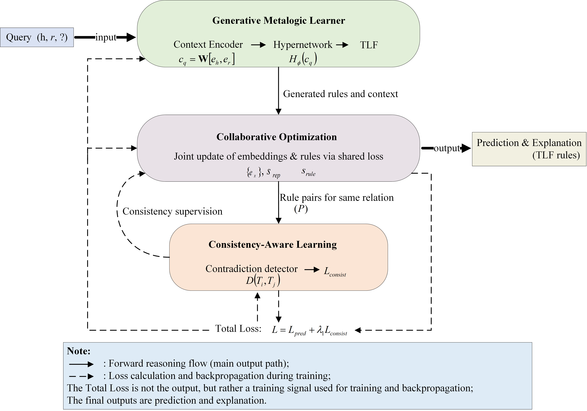

# MetaLogic

MetaLogic, a generative meta-learning framework for synergistic rule and representation learning. 

# Model Architecture

<div align=center>

</div>

 Schematic illustration of the proposed MetaLogic model


# Requirements

To run the codes (Python>=3.8), you need to install the requirements:
'''
activations             0.1.0
dataclasses             0.6
h5py                    3.11.0
numpy                   1.24.3
pillow                  10.4.0
pip                     24.2
pytorch-lightning       1.3.1
pytz                    2025.2
PyYAML                  5.4.1
scikit-learn            1.0
scipy                   1.10.1
setuptools              75.1.0
tensorboardX            2.4
Theano                  1.0.5
torch                   2.4.0
torchvision             0.19.0
tqdm                    4.67.1
transformers            4.19.0
urllib3                 2.2.3
utils                   1.0.1
wandb                   0.12.1
wheel                   0.44.0
yarl                    1.15.2
zipp                    3.20.2
'''

# Data Preprocess

  You can download the data of WN18/WN18RR/Family/Kinship/UMLS from [LERP](https://github.com/Glaciohound/LERP) or [SGKGE](https://github.com/RuizhouLiu/SGKGE) repositories.

To train and evaluate MetaLogic on WN18RR dataset:
```
python D:\pycode\Logic-code\MetaLogic\src\eval\collect_all_facts.bat  D:\pycode\Logic-code\MetaLogic\graph_completion\datasets\WN18RR

python D:\pycode\Logic-code\MetaLogic\src\eval\get_truths.py  D:\pycode\Logic-code\MetaLogic\graph_completion\datasets\WN18RR

python D:\pycode\Logic-code\MetaLogic\graph_completion\src\train\main.py `

python D:\pycode\Logic-code\MetaLogic\graph_completion\src\eval\evaluate.py `
    --preds="D:\pycode\Logic-code\MetaLogic/log/wn_log/WN18RR/test_predictions.txt" `
    --truths="D:\pycode\Logic-code\MetaLogic\graph_completion\datasets\WN18RR\truths.pckl"
```
The same applies to other datasets.


# Acknowledgement

Thanks to the following people for their work.

Yongfang Li: Conceptualization, Methodology, Investigation, Software, Validation, Writing - original draft; 
Chunhua Zhu: Funding Acquisition, Writing–review, Supervision; 
Yuhong Zhang: Funding Acquisition, Writing - review & editing, Formal analysis;
Meng Zhao: Review & editing; 
